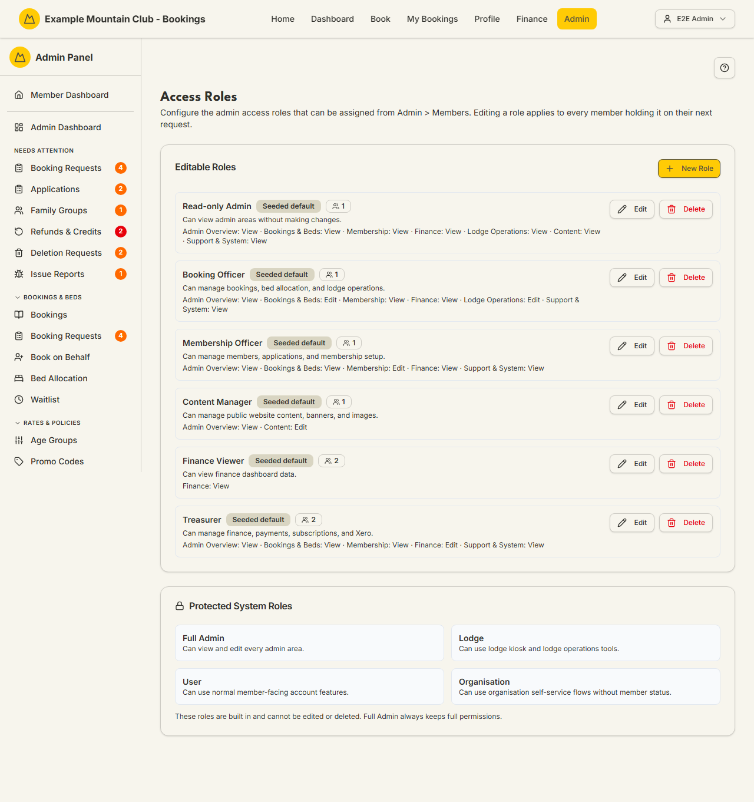

# Access Roles

Audience: Operator

## What it is

Where you define the **custom admin roles** your club can hand out — each role a
named bundle of permissions across the admin areas. Assigning a role to a member
(from **Admin → Members**) is what gives them their admin access; this page
decides what each role can see and do. Find it at **Admin → Setup &
Configuration → Access Roles** (`/admin/access-roles`).

Only **Full Admins** see this sidebar entry and can reach the page. Editing a
role takes effect for every member holding it on their next request. See
[`ARCHITECTURE.md`](../ARCHITECTURE.md) (access roles / definitions) for the
underlying model.

## When you'd use it

- You want a committee member to manage bookings but never touch finance or
  member data — create a role with **Edit** on Bookings & Beds and **None**
  elsewhere.
- You're onboarding a treasurer and want a finance-only role.
- A role's remit changed and you need to widen or narrow what it can do.

## Step-by-step

### Create or edit a role

1. Go to **Admin → Setup & Configuration → Access Roles**. Each custom role
   shows its name, description, permission summary, and how many members hold it.

   

2. Click **New role** (or the pencil to edit one). Give it a **name** and
   **description**, then set each admin area to **None**, **View**, or **Edit**
   in the permission grid.
3. Save. To remove a role, use the delete action — a role still assigned to
   members can't be removed until those members are moved off it.
4. Assign the role to people on **Admin → Members**; this page only defines it.

## Settings reference

Each custom role carries a name, a description, and a permission level per admin
area:

| Permission area | Covers |
| --- | --- |
| Admin Overview | The dashboard and cross-area overview |
| Bookings & Beds | Bookings, requests, beds, waitlist, seasons, promos |
| Membership | Members, applications, family links, memberships, inductions, communications |
| Finance | Fees, payments, subscriptions, refunds, Xero, reports |
| Lodge Operations | Hut leaders, rosters, chores, work parties, lodge settings, rooms/beds |
| Content | Page content, site chrome, banners, public images, site style |
| Support & System | Setup, modules, security, audit, health, notifications |

| Level | Meaning |
| --- | --- |
| None | No access to that area |
| View | Read-only |
| Edit | Full read/write |

**Protected system roles** — Full Admin (`ADMIN`), Lodge (`LODGE`), User
(`USER`), and Organisation (`ORG`) — are code-defined, shown for reference, and
can never be edited or deleted here.

**Areas also decide who is emailed.** Every admin alert belongs to one of these
areas, and a role is only offered — and only ever sent — the alerts for the
areas it can **edit**. Giving a role Bookings edit is therefore what makes
booking-change and exception-request alerts reach it. See
[Recipients](notification-recipients.md) for the alert-to-area table.

**Areas also decide what AI Diagnostics can look up.** Any signed-in administrator
may open AI Diagnostics, but opening it grants nothing by itself: the server re-reads
the administrator's current areas on **every** question and on **every** lookup, and
offers only the tools their areas cover.

- General system evidence — diagnostics readiness, deployment/release, diagnostics
  spend, background-job health, system and security event correlation — needs
  **Support & System** at View.
- Domain diagnostics use their **own** area, not Support & System. Booking evidence
  needs Bookings at View; membership evidence needs Membership; payment, refund and
  Xero evidence needs Finance.
- Evidence that spans the audit trail *and* a business domain needs **both** — for
  example, correlating booking events needs Support & System **and** Bookings.
- A Full Admin holds every area, so they can investigate the whole case.

Where an area is missing, Diagnostics says so and names the permission required. It
never fills the gap from another source, and it never performs an action: it explains
the current state, identifies what is blocking it, and describes what an authorised
administrator would do next. A role change takes effect on the very next lookup, so
removing an area mid-conversation stops the evidence immediately. Full detail in
[`docs/ai-diagnostics/tool-pack-support.md`](../ai-diagnostics/tool-pack-support.md).

**Areas also decide which admin menu someone opens on.** The admin sidebar
shows a short menu for the work a role does, worked out from its areas, never
from its name (so custom roles follow the same rule):

| Menu | Who opens on it | What it shows |
| --- | --- | --- |
| Admin Panel | Full Admins; anyone who can only view, with Membership, Content or Support among their areas (Read-only Admin) | The full admin menu, as before |
| Finance Panel | Anyone who edits Finance, or only views it (Treasurer, Finance Viewer) | Finance Dashboard, the Finance section, Subscriptions, Integrations, and the refund and unpaid-stay queues |
| Bookings Panel | Anyone who edits Bookings & Beds or Lodge Operations (Booking Officer) | Bookings & Beds, Bookings Setup, Rates & Policies, Finance, Lodge Operations, and the booking-request, unpaid-stay and hut-leader queues |

Someone whose edit areas span more than one menu gets a switcher at the top of
the sidebar, and every menu has a **Full admin** button that shows every page
their areas allow. The sidebar remembers the last choice in that browser. The
menus are display only: a page left out of a short menu can still be opened
from the full menu or the search (Ctrl K), and a page the role cannot open
appears in neither. On staff pages (`/admin` and the `/finance` workspace) the
top bar also leaves out Book, My Bookings and Who's at the lodge; those stay on
the member pages.

## Troubleshooting

| Symptom | Likely cause | Fix |
| --- | --- | --- |
| No Access Roles entry in the sidebar | You are not a Full Admin | Only Full Admins can manage roles; ask one |
| A page is missing from the sidebar | You are on the Finance or Bookings menu | Press **Full admin** at the top of the sidebar, or search with Ctrl K |
| A role won't delete | Members still hold it | Reassign those members first, then delete |
| A member still can't reach an area | Their role's level for it is None/View, or the change hasn't taken effect | Adjust the role; changes apply on the member's next request |
| A system role can't be edited | It is a protected built-in role | Create a custom role instead |

## Related links

- Back to the [documentation hub](../README.md).
- Sibling guides: [Members](members.md) (where roles are assigned),
  [Committee](committee.md), [Login & Security](security.md),
  [Recipients](notification-recipients.md) (which alerts each area receives).
- Reference: access roles / definitions in [`ARCHITECTURE.md`](../ARCHITECTURE.md).
