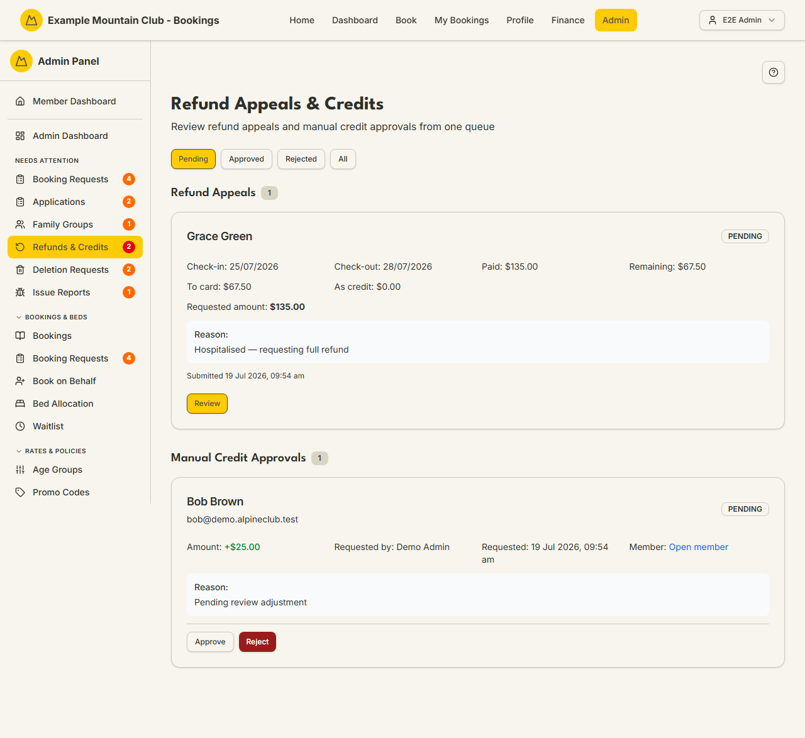

# Refunds & Credits

Audience: Operator

## What it is

One review queue for two money-back flows: member **refund appeals** (approve a
refund to the original card or as account credit, or reject) and admin-raised
**manual credit approvals** (a second admin approves a credit adjustment). Find it
at **Admin → Finance → Refunds & Credits** (`/admin/refund-requests`). It also
appears under **Needs Attention** while requests are pending.

Refunds & Credits is a **finance** permission area: finance view to read the
queue, finance **edit** to approve, reject, or process. Amounts are integer cents;
a refund is capped at the remaining refundable amount on the payment, less any
refund the club has already promised back by bank transfer for an earlier booking
change and not yet sent ([Payments](payments.md)), and any card refund on the
payment not yet made (being retried, or stopped and listed on [Stuck States](stuck-states.md#close-a-card-refund-stripe-gave-up-on)).

## When you'd use it

- A member has appealed a cancellation refund and you need to decide the amount and
  method.
- An admin has requested a manual account-credit adjustment that needs a second
  admin's approval.
- You are auditing approved or rejected refunds and credits.

## Step-by-step

### Review the queues

1. Go to **Admin → Finance → Refunds & Credits**. Filter by **Pending** (the
   default), **Approved**, **Rejected**, or **All**. The page shows **Refund
   Appeals** and **Manual Credit Approvals**. **Reset** restores Pending while
   preserving unrelated URL context.

   

### Approve or reject a refund appeal

1. On a pending appeal, click **Review**. Set the **Refund Amount ($)** (pre-filled
   to the smaller of the requested and maximum refundable amount; the max is shown)
   and optional **Admin Notes** (visible to the member).
2. Click **Approve & Refund** — a dialog asks whether to email the member; the
   refund is processed either way and your choice is recorded in the audit log. Or
   click **Reject** (also with an email choice).

   If the appeal's booking has **No emails** switched on
   ([Bookings](bookings.md#turn-off-all-emails-for-one-booking)), the outcome
   email cannot be sent either way, so the dialog says so and offers only
   **Approve refund** / **Reject appeal**. The money still moves exactly as it
   would have; the withheld outcome email is listed on the booking for you to
   relay.

   **Manually settled (cash / off-Xero) payments cannot be approved here.** If
   the booking's payment was recorded with **Record manual payment** on the
   booking page, approving its appeal is refused (a 409 with the reason) —
   there is no card money to refund, so approving would silently refund $0
   while telling the member money is coming. The booking's cancellation
   already raised a **manual refund task** in the queue on **Admin → Finance →
   Payments** (`/admin/payments`) for what the cancellation policy returns;
   complete the task there once the club has actually paid the member back (or
   dismiss it, with a note, if the member declined or it was settled another
   way). Settle any further refund with the treasurer.

   **Internet banking bookings get a bank-transfer task (#3827).** When the
   booking was paid by internet banking (reconciled in Xero), there is no card
   to refund either, but approving works: the approved amount, or the part of
   it a card refund cannot carry on such a booking paid partly by card, raises one
   **refund task** in the queue on **Admin → Finance → Payments**, and the
   member's email says the club **will** refund them by bank transfer. Send the
   money, then mark the task paid back there; that is when the payment records
   the refund, and when the app queues this appeal's own Xero refund credit
   note for exactly the amount paid back. Approving queues no note for that
   part (a card refund's note is still queued at approval). Each appeal gets
   its own note, so a second appeal on the same booking gets one too. Until
   the task is done its amount counts as already promised, so a second appeal
   on the same booking can only be approved for what is left. See
   [Payments](payments.md#pay-back-a-refund-for-a-cash-booking).

   **Money already returned another way is not offered again.** The most you
   can approve also leaves out any refund task still open on the booking's
   payment (including one a cancellation raised, for example for an
   organisation's late bank transfer), any account credit the member
   already received because their bank transfer arrived after the booking was
   cancelled, and any card refund on the payment not yet made: one refused
   or failed after the card provider accepted it, and being retried, or one
   stopped and listed on [Stuck States](stuck-states.md#close-a-card-refund-stripe-gave-up-on) for you to close as paid another way. When a
   card refund is what lowered it, the review shows "Less $X of card refund not
   yet made for this payment (retrying, or stopped and listed on Stuck states)."
   under **Max refundable**, never more than it actually took off. The member's
   own appeal form uses the same limit, and tells the member how much is still
   owed back to them.

   **A group joiner's booking the organiser paid for by card is refunded to the
   organiser's card (#3956).** When a group organiser paid for everyone in one
   card payment, the joiner's booking has no card payment of its own, so
   approving its appeal refunds the amount out of the organiser's payment, back
   to the card the organiser paid with. The refund is made straight away, or
   retried automatically if the card provider does not answer. Its Xero refund
   credit note is queued once the refund has gone through, not at approval. The
   joiner is emailed that the refund went (or is on its way) to the organiser's
   card, and the organiser is emailed that it is being refunded to their card
   for that joiner's share. Your notify choice covers both emails. The most you
   can approve is what the organiser's payment can still return for this booking
   after the group's cancellation refunds; the review screen says so under
   **Max refundable**, and the joiner's appeal form says the same. Approving
   more is refused with a message naming how much can still be refunded;
   approve that amount or less, or decline the appeal. When that payment has
   nothing left for the booking, the appeal can only be declined. While the
   group cancellation's own refund to the organiser's card has not been made
   yet (an older group cancellation still being retried), approval is refused
   until it has.

   A booking paid by **card** whose card ledger shows less refundable than the
   amount you approve refunds what the card can carry and logs the difference
   for investigation; it never turns into a bank-transfer task.
3. The settlement shows how much went **to card** versus **as credit**, including
   any restored prior credit.

### Approve or reject a credit adjustment

1. On a pending manual credit approval, click **Approve** or **Reject**. If *you*
   raised the request, you cannot approve it — "Needs another admin to approve this
   request" — this is the two-person rule. An approved adjustment is applied to the
   member's credit ledger.

## Settings reference

This is a review queue — its per-review inputs:

| Control | What it does | Notes / constraints |
| --- | --- | --- |
| Status filter | Pending / Approved / Rejected / All | Default is Pending; synced to the URL |
| Reset | Restore Pending | Always visible; disabled at defaults; preserves unrelated URL context |
| Refund Amount ($) | The amount to refund | Entered in dollars; capped at the remaining refundable amount |
| Admin Notes | Note visible to the member | Optional |
| Notify choice (approve/reject) | Whether the member is emailed | Recorded in the audit log either way |
| Approve / Reject (credit) | Action a manual credit adjustment | Two-person rule: the requester cannot approve |

Paid membership subscriptions are not refunded; cancellation credit and GST are
governed by the [cancellation policy](../CANCELLATIONS.md#refund-policy).

## Troubleshooting

| Symptom | Likely cause | Fix |
| --- | --- | --- |
| Everything is read-only ("… can view refund appeals and credit approvals but cannot approve, reject, or process them") | Your finance role is view-only | Ask a finance-edit admin |
| A credit approval is disabled for me | You raised it — the two-person rule needs a different reviewer | Ask another admin to review it |
| The refund amount won't go above a certain figure | It is capped at the remaining refundable amount (paid minus already refunded, minus any refund task still waiting to be sent by bank transfer, minus account credit already given for a bank transfer that arrived after the cancellation, minus any card refund not yet made: retrying, or stopped and listed on Stuck States) | Refund up to that cap; the rest may already be refunded, credited or promised back |
| Approving a group joiner's appeal says the organiser's card payment "can refund at most" a smaller amount | The organiser paid for the group by card, and that one payment has already returned money for the group's cancellation or other changes (#3956) | Approve the amount it names or less, or decline the appeal |
| Approving a group joiner's appeal says the organiser's card payment "has nothing left to refund for it" | That payment has already returned everything it can for this booking (#3956) | Decline the appeal |
| Approving a group joiner's appeal says the group cancellation's own refund "is still being made or reconciled" (the review screen says the same where it would show the maximum, and the member is told to appeal once it is made) | An older group cancellation's single refund to the organiser's card is still being retried (#3956) | Wait for the automatic retry to make that refund, then approve; or decline the appeal. If no retry has started yet it shows under **Unexecuted group settlement refunds**, and if the retry has used all its attempts under **Exhausted recovery operations**, both on [Stuck States](stuck-states.md), which does not close this kind of refund: ask a developer to reconcile it |
| The queue is empty | The status filter excludes the request | Switch to **All** to see approved/rejected items |

## Related links

- Back to the [documentation hub](../README.md).
- Feature hub: [Finance dashboard](../finance-dashboard/README.md).
- Sibling guides: [Payments](payments.md), [Subscriptions](subscriptions.md),
  [Cancellation Requests](membership-cancellations.md), [Members](members.md).
- Reference: the
  [refund and credit lifecycle](../STATE_MACHINES.md#refund-and-credit-lifecycle),
  the [refund policy](../CANCELLATIONS.md#refund-policy) and
  [GST treatment](../CANCELLATIONS.md#gst-treatment) in `CANCELLATIONS.md`, and
  the [payment and settlement invariants](../invariants/payment-and-settlement.md).
